# Release 1 end-to-end review: the 90 rows not yet Works (18 Nov 2026)

**Why this page exists.** The founder asked, 18 Nov, before going to full power: "do we want to have an end-to-end review that we are not over duplicating or ... missing anything, any gap, any functionality, any capability? ... the end-to-end and dependency graph, and then accordingly, let's build very smartly ... Not build to partials" (STATE ask A169, `STATE.md` on `origin/lead/2026-11-07-lead31`). This page is that review, read-only: it changes no other file.

**Scope.** Release 1 has 101 Build rows (`MVP-CHECKLIST.md`:13). qa's newest verdicts (`qa/CAPABILITIES.md` on `origin/claude/qa-after-merge-1118b`, fb2e6d5f8, 18 Nov 16:35 IST) give **11 Works, 34 Partial, 56 Not built**. The 11 Works rows (R1.2, 9, 11, 12, 63, 73, 82, 83, 84, 99, 101) are out of scope. The other **90** are covered below.

**How to read the sources.** Every claim carries a tag:
* `CAP:L…` = line in `qa/CAPABILITIES.md` on `origin/claude/qa-after-merge-1118b` (the qa row, its status date and its evidence).
* `MVP:L…` = line in `MVP-CHECKLIST.md`. `BL:L…` = line in `BACKLOG.md` (both as on `origin/lead/2026-11-07-lead31`, 18 Nov).
* `#nnnn` = a pull request merged on `origin/main` (head fa2c6865c, 18 Nov 18:32 IST, the last merge #2003).
* `branch:` = work in flight on a GitHub branch, not merged (read with `git for-each-ref`, 18 Nov).
* `P-nnn` = a row in `DECISIONS.md` or `RULES.md`. `LB rev 17.x` = Lead B's rows file `design/lead-b-rows-2026-11-14.md` on `origin/lead-b-front-office`. `REQ:` = the team's requirements copy `domain/requirements-2026-11-02/`.
* **Inference** marks anything I concluded rather than read.

**Plain words for the technical terms.**
* *Part*: one backlog row = one pull request (PR) of under about 800 lines (P-610). A capability (an R1 row) usually needs several parts.
* *Merged* means the code is on `main`; *Works* means qa has independently proven it end to end (P-339). Merged is not Works.
* *Port* and *fake*: a port is one agreed doorway between modules (for example `FilesPort` for storing files); a fake is a stand-in behind that doorway for tests, used until the real one (for example Amazon storage) is connected.
* *Schema* and *migration*: the database's table layout and the script that changes it. *Schema baton*: only one builder at a time changes a shared schema file (P-438b, P-600).
* *Join and walk* (J- rows): the last part of a multi-part capability that wires the parts together and has a person walk it on screen (P-606 (5)).
* *Gate A / Gate B*: qa walks the capability by screens to the next one's first step (P-348c); no open Major or Critical bug on it (P-305).
* *CI*: GitHub's automatic test runs on every change. *Merge queue*: the line every approved PR waits in to be merged.
* *Hub part*: one backlog row that many capabilities wait on.

---

## 1. Coverage table (90 rows)

"Done" = parts merged (PR numbers). "Left" = parts not merged. "In flight" = a branch exists on GitHub but is not merged. "Blocked by" = what stops the row finishing now. Status and date are qa's (CAP).

### A. Foundations and running the service
| R1 | Name | qa status (date) | Backlog rows | Done | Left | Blocked by | Source |
|---|---|---|---|---|---|---|---|
| R1.1 | Hosting, data, backups, logs in Canada | Not built (14 Nov) | PF-7, PF-8a, PF-8b, PF-8c, PF-23c | PF-7 (#1713) | PF-8a, PF-8b, PF-8c, PF-23c | founder's AWS account (C21); PF-8a needs no account (synth only, BL:L948) and can start now | CAP:L138, MVP:L28, BL:L948-950 |
| R1.3 | Walls between firms | Not built (14 Nov; stale: PF-12 merged since) | PF-12, CS-W1, CS-W2, CS-W3, CS-W4 | PF-12 (#1910) | CS-W1 to CS-W4 | CS-W2 waits on the contract §8 spike and the Bake's tag (P-499); launch condition C2 | CAP:L140, MVP:L30, BL:L1085-1088 |
| R1.4 | Each query runs inside its firm | Partial (16 Nov) | PF-12 (+ fix for QA-499) | PF-12 (#1910) | the bypass audit line (QA-499) | in flight: PF-12b part 1 (`branch: claude/runtime-pf12b-bypass-audit`, Approve ca2382c); PF-12b has no BACKLOG row | CAP:L141 |
| R1.5 | Staff sign-in, two-step, passkeys, lock-out | Partial (15 Nov) | PF-4, PF-4b, PF-4bc, PF-4s, J-5 | PF-4 (#1744), PF-4t (#1775), PF-4b (#1816), PF-Lc (#1820), PF-4f (#1784) | PF-4bc, PF-4s, passkeys on the real pool, wrong/expired-code tests, J-5; PF-4dn in flight (#2109) | passkey proof needs the AWS account (J-5, BL:L1099) | CAP:L142, MVP:L32 |
| R1.6 | Permissions: deny by default, own vs all, money and licence apart | Partial (18 Nov) | PF-4, PF-6, PF-6b, J-6 | PF-6b (#1808), PF-6 part 1 (#1912), part 2a (#2044), PF-6r (#1951), PF-6f (#1952), PF-6m (#1945), PF-6m2 (#2045), FO-2v (#1933) | PF-6 part 2b, J-6 part 2 | nothing outside the lane | CAP:L143 |
| R1.8 | Audit trail nobody can edit | Not built (14 Nov; stale: AUD-1a merged 18 Nov) | AUD-1a, AUD-1b, AUD-1m (parts 1, 2a, 2b), PF-0a | AUD-1a (#2003) | AUD-1b, AUD-1m ×3, PF-0a | AUD-1b first (hub: see §4) | CAP:L144, MVP:L274 |
| R1.10 | Checking every input | Not built (14 Nov; stale) | PF-28, CS-V1 parts 1, 2, 3a, 3b | CS-V1 part 1 (#2007), part 2 (#2042), PF-0bp (#2087) | PF-28, CS-V1 3a, 3b | CS-V1 PR 3 waits on the Bake's tag and CS-D1b (BL:L1069) | CAP:L146, MVP:L272 |
| R1.13 | Logs, metrics, error reports, alerts | Partial (15 Nov) | PF-23, PF-23r, PF-23m, PF-23w, PF-23c | PF-23 (#1759), PF-23r (#1812), PF-23w (#1800) | PF-23m, PF-23c; re-score of QA-452 after PF-23w | PF-23c needs the AWS account and the founder's on-call address (BL:L292) | CAP:L149, MVP:L39 |
| R1.14 | Backups with a tested restore | Not built (14 Nov) | PF-8r, PF-8rc | — | PF-8r (in flight #2014, labelled), PF-8rc | PF-8rc needs the AWS account (BL:L952) | CAP:L150, MVP:L40 |
| R1.15 | Secrets in a managed store | Partial (15 Nov) | PF-24, PF-24w, PF-8b | PF-24 (#1756) | PF-24w (in flight, `branch: claude/nifty-sagan-q6u4k3`), the cloud store in PF-8b | AWS account | CAP:L151, MVP:L41 |
| R1.16 | Automated testing | Partial (16 Nov) | PF-7 (+ QA-449) | PF-7 (#1713) | container smoke on main's code at every merge (QA-449) | no BACKLOG row owns QA-449 (gap G10) | CAP:L152 |

### B. The firm as our customer
| R1 | Name | qa status (date) | Backlog rows | Done | Left | Blocked by | Source |
|---|---|---|---|---|---|---|---|
| R1.19 | A firm is created once, with plan, trial, owner | Partial (16 Nov) | PF-5, PF-5s, PF-5v, J-19 | PF-5 part 1 (#1815), PF-5v part 1 (#1955) | PF-5 part 2 (in flight, `branch: claude/happy-tesla-ofoebq`), PF-5s, PF-5v part 2 (QA-481), trial end, J-19 | J-19 needs the founder's Stripe test account (BL:L1107) | CAP:L153, MVP:L47 |
| R1.20 | One entitlement check; seat and plan limits; downgrade; invite many | Partial (18 Nov) | PF-5, PF-15, PF-4c, PF-6 | PF-4c part 1 (#2052) | PF-4c part 2, PF-15 parts 1-2, the Invite screen's batch (PF-6) | founder decision: 1-50 rows keeping good rows (R1.20) vs PF-4c's 1-20 rows sending none while one is flagged (STATE ask (a)); PF-15 held by P-663 (LB rev 17.15) | CAP:L154, MVP:L48 |
| R1.21 | Our own invoices with sales tax | Not built (16 Nov) | PF-5 (Stripe Tax), PF-5s | — | PF-5 part 2, billing page in PF-5s | Stripe test account | CAP:L155, MVP:L49 |
| R1.22 | Suspend, cancel, failed-payment hold, data download on exit | Not built (14 Nov) | PF-5, PF-11 (parts 1-3), PF-11s, PF-27, PF-11c | — | all | PF-11c waits on AUD-2, AUD-5, PF-21b, PF-5, PF-14 (BL:L991); PF-27 waits on PF-4s; the case side's export section has no row (gap G5) | CAP:L156, MVP:L50 |
| R1.23 | Firm logo, colour, sender name, favicon, banner | Not built (14 Nov) | PF-13 parts 1-2 | — | PF-13 | nothing: all its waits (PF-4, FO-5's FilesPort, PF-1) are merged (BL:L333) | CAP:L157, MVP:L51 |
| R1.24 | Each firm's own web address | Partial (15 Nov) | PF-25, PF-25w, PF-8b, J-24 | PF-25 (#1763) | PF-25w, wildcard DNS and certificate (PF-8b), J-24 | PF-25w waits on PF-4s; DNS needs the AWS account | CAP:L158, MVP:L52 |
| R1.89 | Public pricing page | Not built (14 Nov) | PF-5s | — | PF-5s | PF-5 part 2 | CAP:L159, MVP:L53 |
| R1.90 | Self-serve sign-up, email check, no-card trial, private links, banners | Not built (14 Nov) | PF-5, PF-5s, PF-16 | (PF-5 part 1's sign-up API, #1815) | PF-5 part 2, PF-5s, PF-16 | PF-16 waits on PF-15 (BL:L360) | CAP:L160, MVP:L54 |
| R1.91 | Plans, change, cancel, invoices, card update, yearly, refunds, billing emails | Not built (14 Nov) | PF-5, PF-5s, PF-16 | — | all | PF-15, Stripe test account | CAP:L161, MVP:L55 |
| R1.92 | Firm profile, offices and time zones, licence-number check | Not built (14 Nov) | PF-5s, PF-18a, PF-18s, PF-4c | — | PF-18a parts 1-2, PF-18s, PF-4c part 2, PF-5s | PF-18a after PF-15 on the platform schema baton (BL:L362) | CAP:L162, MVP:L56 |
| R1.93 | Our team's console; health per firm; support button | Not built (14 Nov) | PF-4s, PF-17, PF-18b, PF-18s | — | PF-4s, PF-17, PF-18b (in flight, `branch: claude/runtime-pf18b-support`), PF-18s | PF-17 waits on PF-4s, PF-5, PF-15, PF-16 (BL:L361) | CAP:L163, MVP:L57 |
| R1.100 | Recorded acceptance of our terms, privacy notice, data agreement | Partial (17 Nov) | PF-5, PF-5t, PF-5v | PF-5t part 1 (#1957) | PF-5t part 2 (screens), PF-5v part 2 (QA-481) | P-663 holds PF-5tv (LB rev 17.12); the terms text itself does not exist yet (C24, gap G9) | CAP:L164, MVP:L58 |

### C. Enquiries, leads and pipeline
| R1 | Name | qa status (date) | Backlog rows | Done | Left | Blocked by | Source |
|---|---|---|---|---|---|---|---|
| R1.26 | Public enquiry form, hardened against abuse | Not built (14 Nov; stale) | FO-2, FO-4, FO-4b | FO-2 part 1 (#1813), part 2 (#1843), FO-4 part 1 (#1822) | FO-4b; a re-score (Inference: the hosted form exists) | qa re-score | CAP:L165, MVP:L63 |
| R1.27 | Every lead carries a source | Partial (16 Nov) | FO-1a, FO-2, FO-4sf, J-27 | FO-1a (#1742), FO-4sf (#1962) | FO-4b, J-27 | FO-4b waits on FO-4's settings panel (BL:L324) | CAP:L166, MVP:L64 |
| R1.28 | Consent recorded per purpose | Partial (18 Nov) | PF-19a, FO-2, PF-19b | PF-19a (#1754), PF-19b part 2 (#1956) | FO-2 part 3 | nothing outside the lane | CAP:L167, MVP:L65 |
| R1.29 | One person record; duplicate warning; safe merge | Partial (18 Nov) | FO-1a, FO-9a, FO-9b, FO-9s, J-29 | FO-9a part 1 (#2062), FO-9b part 0 (#2021) | FO-9a later parts, FO-9b parts 1-2, FO-9s, J-29 | FO-9s waits on FO-4's record screen (BL:L344) | CAP:L168, MVP:L66 |
| R1.30 | Lead lists, filters and board | Partial (16 Nov) | FO-4 | FO-4 part 1 (#1822), FO-4sf (#1962) | filters by stage, owner, date (API ignores them); the board | nothing outside the lane | CAP:L169, MVP:L67 |
| R1.31 | Stage kinds; won by signature; totals per currency | Not built (16 Nov) | FO-2, FO-4 | — | prospects API (404 today), Won moves, totals | Won by signature waits on FO-6's routes (signature event) | CAP:L170, MVP:L68 |
| R1.32 | Assign, take, reassign; Unassigned; assignment rules | Not built (14 Nov; stale) | FO-4, FO-10 | FO-2 part 2's Assign and Take (#1843) | FO-10 (rules), FO-4 screens | FO-10 waits on PF-20's automation engine (BL:L345) | CAP:L171, MVP:L69 |
| R1.33 | Phone numbers | Not built (14 Nov; stale) | FO-2, FO-9a | FO-9a part 1 match keys (#2062) | E.164 storage and field refusal; FO-9a later parts | re-score | CAP:L172, MVP:L70 |
| R1.34 | One person's data as an export, logged | Not built (14 Nov) | PF-26 (parts 1, 1b, 2), PF-26s, CS-X1 (parts 1-3) | — | all | PF-26 waits on FO-9b; CS-X1 on CS-D1 and CS-K1; PF-26s on FO-4 and PF-18n (BL:L295, L959, L1074) | CAP:L173, MVP:L71 |
| R1.35 | Contacts import from a spreadsheet | Not built (14 Nov) | PF-10a, PF-10b, PF-10t, PF-10s | — | all | question 7 (.xlsx library, a Lead gate ruling); PF-18n (BL:L995) | CAP:L174, MVP:L72 |
| R1.36 | Simple automation, message many with consent | Not built (14 Nov) | PF-20, PF-20s, FO-10, FO-12b, FO-12c, FO-12s | — | all | PF-20 waits on PF-19b (merged parts) and PF-14 (merged); PF-20s on PF-19s (BL:L387-388) | CAP:L175, MVP:L73 |
| R1.95 | Custom fields and saved views | Not built (14 Nov) | PF-22a, PF-22v, PF-22s | — | all | question 8 (field types and limits) open (BL:L998) | CAP:L176, MVP:L74 |
| R1.98 | Corporate clients, employers, LMIA | Partial (17 Nov) | FO-2b, FO-8, CS-98r, CS-98a to e, CS-98s1, s2, s3a to s3c | FO-2b (#2019) | FO-8 and the 11 LMIA rows | P-607 (5): scheduled last; FO-8 waits on AUD-1 (BL:L325); CS-98r needs cited LMIA rules | CAP:L177, MVP:L75, BL:L1137-1147 |
| R1.108 | Conflict-of-interest check | Not built (14 Nov; stale) | FO-13, FO-13c, FO-13s | FO-13 tables (#1755) | FO-13c, FO-13s | FO-13c waits on FO-9a; launch condition C32 (College rules read; Unconfirmed: no counsel) | CAP:L178, MVP:L76 |
| R1.110 | Client identity check | Not built (14 Nov; stale) | FO-13, FO-13i, FO-13s | FO-13 (#1755) | FO-13i (in flight #2011, needs a typed audit actor after #2003, LB rev 17.18), FO-13s | FO-13s waits on FO-13c and FO-4 (BL:L356) | CAP:L179, MVP:L77 |

### D. Booking
| R1 | Name | qa status (date) | Backlog rows | Done | Left | Blocked by | Source |
|---|---|---|---|---|---|---|---|
| R1.37 | Public booking page; no double booking | Partial (15 Nov) | FO-1b, FO-3, FO-3w, FO-3a, J-37 | FO-1b (#1741), FO-3 (#1760), FO-3f (#1785), FO-3pa (#1830), FO-3w parts 1-2 (#1921, #1982) | J-37; re-score after FO-3w | nothing outside the lane | CAP:L180, MVP:L82 |
| R1.38 | Time zones from booking page to invite | Partial (16 Nov) | FO-3, FO-3st1, J-38 | FO-3 (#1760), FO-3h (#1799) | FO-3st1 (staff zone on screen), J-38 | FO-3st1 waits on FO-3a parts 2a/2b and PF-18a (BL:L961) | CAP:L181, MVP:L83 |
| R1.39 | Staff calendar screen | Not built (14 Nov) | FO-3st1 parts 1-2, FO-3sc | FO-3sc concept (records) | FO-3st1 | as R1.38 | CAP:L182, MVP:L84 |
| R1.40 | Calendar invite files | Partial (16 Nov) | FO-3, J-38 | FO-3 (#1760), FO-3w part 2 (#1982) | J-38 (shared with R1.38) | as R1.38 | CAP:L183, MVP:L85 |
| R1.41 | Staff hours and time off | Partial (18 Nov) | FO-1b, FO-3, FO-3a, FO-3st2, J-41 | FO-3a part 1a (#1918) | FO-3a part 1b (in flight, `branch: claude/runtime-fo3a1b`), FO-3st2, J-41 | P-663 hold on new rows (LB rev 17.17) | CAP:L184, MVP:L86 |
| R1.42 | Reschedule or cancel by link; outcomes; consult record | Partial (18 Nov) | FO-3, FO-3a, FO-3w, FO-3st1, FO-3st3, J-42 | FO-3w part 2 (#1982), FO-3sr (#1811), FO-3sa (#1828) | FO-3a parts 2a (in flight, `branch: claude/runtime-fo3a2`) and 2b, FO-3st1, FO-3st3, J-42 | as R1.41 | CAP:L185, MVP:L87 |
| R1.43 | Two-way Google calendar sync | Not built (14 Nov) | FO-3s1, FO-3s2, FO-3s4, FO-3s5 (FO-3s3 Microsoft deferred, P-621) | — | all | Google OAuth client (founder's browser, P-580); FO-3s4 waits on PF-18n | CAP:L186, MVP:L88, BL:L964-968 |
| R1.104 | Consultation agreement signed before the first consult | Not built (15 Nov) | FO-3c, FO-5, FO-5s, J-104 | FO-5 part 1 template kind (#1761) | FO-3c, FO-5s, J-104 | FO-3c waits on FO-6 (BL:L322) | CAP:L187, MVP:L89 |
| R1.112 | Video meeting links on bookings | Not built (14 Nov) | FO-3v | — | FO-3v | Meet links wait on calendar sync; Teams moot under P-621 (duplicate D6) | CAP:L188, MVP:L90 |

### E. Templates and messages
| R1 | Name | qa status (date) | Backlog rows | Done | Left | Blocked by | Source |
|---|---|---|---|---|---|---|---|
| R1.45 | Firm templates, field picker, preview with a real record | Not built (14 Nov) | PF-19c, PF-19s, FO-5p | — | all | PF-19c waits on PF-19b (merged parts) | CAP:L189, MVP:L95 |
| R1.46 | Template text editor | Not built (14 Nov) | PF-19s | PF-Le libraries (#1919) | PF-19s | PF-19c | CAP:L190, MVP:L96 |
| R1.47 | One email layout | Partial (16 Nov) | PF-19b | PF-19b part 1 (#1824), booking mail (#1860) | every sender on MessagePort: invitations and the case side's mail skip it (QA-495) | no BACKLOG row (gap G4) | CAP:L191, MVP:L97 |
| R1.48 | Sending, delivery state, bounces, sender name | Partial (18 Nov) | PF-19b, PF-L, J-48 | PF-19b parts 1-2 (#1824, #1956) | "part missing PF-L" (qa), J-48 | nothing outside the lane | CAP:L192, MVP:L98 |
| R1.49 | Consent gate before every send; unsubscribe | Partial (18 Nov) | PF-19a, PF-19b, J-49 | PF-19a (#1754), PF-19b parts 1-2, PF-19ad | QA-495 (case-side link emails and staff mail skip the gate), J-49 | no BACKLOG row for QA-495 (gap G4) | CAP:L193, MVP:L99 |
| R1.50 | In-app notifications; personal settings | Not built (14 Nov) | PF-18np, PF-18a, PF-18n, PF-18s, PF-18ns | PF-18np port (#1898) | PF-18a, PF-18n, PF-18s, PF-18ns | PF-18a on the platform schema baton after PF-15 | CAP:L194, MVP:L100 |
| R1.52 | Connected mailbox; WhatsApp (no SMS) | Not built (14 Nov) | FO-11, PF-19m, PF-19mc, PF-19mi, PF-19mx, PF-19ms | — | all | question 9 (start Google's review; IMAP in Release 1?); Google review clock (weeks); WhatsApp account; PF-18n | CAP:L195, MVP:L101, BL:L1024-1028 |

### F. Retainer and e-signature
| R1 | Name | qa status (date) | Backlog rows | Done | Left | Blocked by | Source |
|---|---|---|---|---|---|---|---|
| R1.53 | Retainer with the regulator's 26 items; versioned | Partial (15 Nov) | FO-5, FO-5b, FO-5s, J-53 | FO-5 parts 1-2 (#1761, #1777), FO-5f (#1791), FO-5f2 (#1809) | FO-5b, FO-5s, J-53 | FO-5s waits on FO-6 and FO-4's prospect screen (BL:L330) | CAP:L196, MVP:L106 |
| R1.54 | E-signature with evidence; any document | Partial (17 Nov) | FO-6, FO-6v, FO-6d, FO-6ds | FO-6 part 2 SigningPort (#2040) | FO-6 part 1 (in flight, `branch: claude/runtime-fo6-signing`), FO-6 routes, FO-6v, FO-6d, FO-6ds | FO-6v held for the founder's BoldSign sandbox (P-561, P-568 (3)) | CAP:L197, MVP:L107 |
| R1.55 | Withdraw, re-issue, decline, signed offline | Partial (15 Nov) | FO-6, FO-5s | FO-5 part 2 routes (#1777) | decline with reason (FO-6), FO-5s | FO-6 | CAP:L198, MVP:L108 |

### G. Client money
| R1 | Name | qa status (date) | Backlog rows | Done | Left | Blocked by | Source |
|---|---|---|---|---|---|---|---|
| R1.56 | Client invoices, tax by province, government-fee line | Not built (14 Nov) | FO-7a, FO-7b, FO-7s0, FO-7g, FO-7q, FO-7s1 | FO-7a (#1758), FO-7s0 concept (#2016) | FO-7b, FO-7g, FO-7q, FO-7s1 | FO-7b (hub); FO-7g needs a cited tax table (official source) | CAP:L199, MVP:L113 |
| R1.57 | Card payment into the firm's operating account | Not built (14 Nov) | FO-7c (parts 1-3), FO-7s2 | — | all | FO-7b; Stripe test keys (founder) | CAP:L200, MVP:L114 |
| R1.58 | Trust or operating on every payment; ledger; "to move" | Partial (18 Nov) | FO-7a, FO-7ts, FO-7t, FO-7s3a, FO-7s3b, FO-7m | FO-7a2 (#1991), FO-7mv (#1924) | FO-7ts parts 1-3 (part 1 in flight), FO-7t parts 1-5, FO-7s3a, FO-7s3b, FO-7m | FO-7b; Done when rewritten by Lead 80, now P-694 | CAP:L201, MVP:L115 |
| R1.59 | Money arithmetic | Partial (16 Nov) | FO-7a, FO-7b | FO-7a (#1758) | tax rounded per line (QA-482) in FO-7b | FO-7b | CAP:L202, MVP:L116 |
| R1.60 | Deposit invoice prepared on signature | Not built (14 Nov) | FO-7b | — | FO-7b | FO-7b and FO-6's signature event | CAP:L203, MVP:L117 |
| R1.96 | Reversals, refunds, credit notes, plans, write-offs | Not built (14 Nov) | FO-7b, FO-7p, FO-7r, FO-7v, FO-7s4 | (credit notes on trust in FO-7a2, #1991) | all | FO-7p waits on FO-7c (BL:L347) | CAP:L204, MVP:L118 |
| R1.111 | Client statement and period exports | Not built (14 Nov) | FO-7r, FO-7s5 | — | all | FO-7r waits on FO-7b, FO-7t (BL:L370) | CAP:L205, MVP:L119 |

### H. Client links and portal
| R1 | Name | qa status (date) | Backlog rows | Done | Left | Blocked by | Source |
|---|---|---|---|---|---|---|---|
| R1.61 | Sign and pay by single-use link | Not built (14 Nov) | FO-6, FO-7c | — | all, and the join of the two | no row joins signing to paying (gap G2) | CAP:L206, MVP:L124 |
| R1.62 | Client login portal; progress stream with "last update" | Not built (14 Nov) | PF-4p, PF-4pw, PF-4ps, FO-14 | — | all | question 10 (which record a portal account belongs to, BL:L1029); FO-14 waits on FO-6, FO-7c and a case-side "Tell the client" event with no row (gap G7) | CAP:L207, MVP:L125 |

### I. Documents
| R1 | Name | qa status (date) | Backlog rows | Done | Left | Blocked by | Source |
|---|---|---|---|---|---|---|---|
| R1.64 | Upload that resumes after a dropped connection | Not built (16 Nov) | PF-F2, CS-D1 | — | PF-F2, CS-D1 (2 PRs) | PF-F2 waits on PF-F4; CS-D1 waits on PF-F2, PF-F3, PF-F4 (BL:L1070) | CAP:L220, MVP:L132 |
| R1.65 | Private storage in Canada: firm keys, versions, encryption | Not built (16 Nov) | PF-F1, PF-F1c, CS-D1 | FilesPort with FO-5 (#1777), PF-Fd (#1997) | PF-F1, PF-F1c, CS-D1 | PF-F1c needs the AWS account | CAP:L221, MVP:L133 |
| R1.66 | Virus scan; nothing served while scanning | Not built (16 Nov) | PF-F3 | — | PF-F3 | P-624: GuardDuty after one console check in the AWS account (gap G8: split the port from the adapter) | CAP:L222, MVP:L134 |
| R1.67 | File-type check | Not built (16 Nov) | PF-F4, CS-D1 | — | PF-F4, CS-D1 | PF-F4 waits on nothing (BL:L1063) | CAP:L223, MVP:L135 |
| R1.68 | Preview for staff review | Not built (16 Nov) | CS-D5 parts 1-2 | PF-Fp part 1 toPdf port (#2028) | CS-D5 | PF-F3, a screen concept, the L-doc series (BL:L1072) | CAP:L224, MVP:L136 |
| R1.69 | Read log, fingerprint, keep-period reminder | Not built (16 Nov) | CS-D6 parts 1-3 | AUD-5 part 1 (#2008) | CS-D6 | PF-F2; CS-X3 for Dispose (BL:L1073) | CAP:L225, MVP:L137 |
| R1.70 | Expiry, translation, notarisation flags | Not built (16 Nov) | CS-D7c, CS-D7 parts 1-2 | — | all | CS-D1; CS-D7c defaults need an official source (AGENTS rule 4) | CAP:L226, MVP:L138 |

### J. Case work
| R1 | Name | qa status (date) | Backlog rows | Done | Left | Blocked by | Source |
|---|---|---|---|---|---|---|---|
| R1.72 | Case with applicants, representative, pinned release | Not built (16 Nov) | C6.1, FO-8, CS-K1 | C6.1 Works, BK-21 (#2041) | FO-8, CS-K1 (FO-8's schema step) | FO-8 waits on AUD-1 (BL:L325); CS-K1 after CS-W1 on `cases.prisma` | CAP:L227, MVP:L143 |
| R1.74 | Government deadlines that remind; working days | Partial (15 Nov) | CS-DL1 parts 1-2 | stage deadline under C6.17 | CS-DL1 | PF-18n (BL:L1042); deadline offsets are Sample until cited | CAP:L208, MVP:L145 |
| R1.75 | Tasks: My Tasks, Unassigned, handover | Not built (16 Nov) | PF-29a to PF-29f, CS-T1 | — | all | PF-29a's home question (Question 6, BL:L1049); PF-18n | CAP:L229, MVP:L146 |
| R1.76 | Notes; one timeline per record | Not built (15 Nov) | FO-2, CS-NT1 parts 1-4 | `fo_note` table (#1742) | CS-NT1, the front-office note routes | CS-W1, PF-18n (BL:L1043) | CAP:L209, MVP:L147 |
| R1.77 | Submission number and UCI; decision, close, reopen | Partial (17 Nov) | C8.2, BK-17, CS-C1 | CS-C1a (#1818), CS-C1b (#2002) | a screen to decide, withdraw, close, reopen (QA-502) | no BACKLOG row for that screen (gap G3) | CAP:L230, MVP:L148 |
| R1.79 | Firm dashboards and reports | Not built (16 Nov) | PF-R1, PF-R2fo, PF-R2cm, PF-R3, CS-R1 parts 1-2 | — | all | CS-R1 waits on CS-T1 and CS-W2 (BL:L1084) | CAP:L231, MVP:L149 |
| R1.102 | Find a person or case | Partial (17 Nov) | CS-S1 parts 1-2, PF-30a, PF-30s | CS-S1 part 1 (#2035) | CS-S1 part 2, PF-30a, PF-30s | CS-S1 part 2 waits on CS-W1 | CAP:L238, MVP:L150 |

### K. Government forms, assessment
| R1 | Name | qa status (date) | Backlog rows | Done | Left | Blocked by | Source |
|---|---|---|---|---|---|---|---|
| R1.80 | IRCC forms per applicant from one set of answers | Partial (16 Nov) | C7.1, C7.8, C7.2, BK-10, BK-16, BK-22 to BK-24 | all parts; C7.1 and C7.8 Works | C7.2 only: QA-165, the Lead's Adobe Validate run | the Lead's run (no build) | CAP:L210, MVP:L155 |
| R1.106 | Assessment AS-1: Express Entry and FSW scores | Not built (14 Nov; stale: AS-1m merged) | AS-1m, AS-1g, AS-1s, AS-1c, FO-15a, FO-15b, FO-15s, CS-106c | AS-1m (#2105) | the other 7 | AS-1c needs IRCC's official grids (P-170); CS-106c waits on FO-8 | CAP:L212, MVP:L160, BL:L1153-1157 |
| R1.107 | Assessment AS-2: five provincial streams, client copy | Not built (14 Nov) | AS-2e, AS-2d1, AS-2d2, AS-2c, AS-2cs | — | all | streams confirmed (P-653 (5)); each needs its province's official page; AS-2cs waits on PF-19s | CAP:L213, MVP:L161 |

### L. Privacy registers and audit views
| R1 | Name | qa status (date) | Backlog rows | Done | Left | Blocked by | Source |
|---|---|---|---|---|---|---|---|
| R1.85 | Data-request register with legal hold | Not built (16 Nov) | PF-21b, PF-21d, PF-21rs, CS-X2, CS-X3 | PF-21b part 1 LegalHoldPort (#2025) | PF-21b rest, PF-21d, PF-21rs, CS-X2, CS-X3 | PF-21b waits on PF-4s; PF-21d on FO-7b; CS-X3 on CS-D1 | CAP:L235, MVP:L166 |
| R1.86 | Breach register with firm notices | Not built (16 Nov) | PF-21c, PF-21rs | — | all | PF-21c waits on PF-19c, PF-23, PF-4s (BL:L298) | CAP:L236, MVP:L167 |
| R1.87 | Our access to a firm's data, logged and shown | Not built (14 Nov) | AUD-3 parts 1-3, AUD-3b parts 1-3, PF-6sb | — | all | AUD-1b, PF-4s (BL:L1127) | CAP:L214, MVP:L168 |
| R1.88 | The firm reads its own audit log | Not built (14 Nov; stale) | AUD-4, AUD-4s parts 1-2 | AUD-4s concept (#2027) | AUD-4, AUD-4s part 2 | AUD-1b (BL:L1129) | CAP:L215, MVP:L169 |
| R1.97 | Tamper-evident audit chain | Not built (14 Nov) | AUD-1c, AUD-2, AUD-2c | — | all | AUD-1a merged; AUD-1c needs nothing else outside; AUD-2c needs the AWS account | CAP:L216, MVP:L170 |
| R1.105 | Keep periods; a leaving firm is closed, not deleted | Partial (18 Nov) | AUD-5, AUD-2, PF-5, PF-11c | AUD-5 part 1 (#2008) | AUD-5 part 2 (in flight, `branch: claude/upbeat-bardeen-k2tdqn`), AUD-2, PF-5's 90-day close, PF-11c | AWS (AUD-2c); College keep period read 15 Nov (CS-D6 row, Unconfirmed: no counsel) | CAP:L217, MVP:L171 |
| R1.109 | Complaints record | Partial (17 Nov) | PF-21, PF-21w, PF-21v, PF-21s, PF-21i, J-109 | PF-21 (#1753), PF-21w (#1823), PF-21v (#1848), PF-21s part 3 (#1998) | PF-21i (in flight #2012), PF-21s part 4, J-109 | nothing outside the lane | CAP:L218, MVP:L172 |

**What the table shows (counts).** 40 of the 90 rows still carry a qa line dated 14 Nov (CAP), and at least 11 of them have had parts merged since (R1.3, 8, 10, 26, 32, 33, 88, 106, 108, 110 and R1.4's PF-12): their status is older than the code. 15 parts are in flight on branches. 34 rows wait on at least one founder action or official source (§5 flags).

---

## 2. Duplicates and overlaps (12 found: 5 to merge, 7 to clean up)

Batch 5 already folded several earlier overlaps into one owner each (CS-R1 registers in PF-R1's registry, CS-S1 is the case finder under PF-30a's `FindPort`, CS-K2 calls FO-9b's `PersonMergePort`, CS-T1 registers hosts with PF-29b's `TaskPort`, CS-D6 calls AUD-5's `KeepPeriodPort`; BL:L1045, L1055, L1080, L1082, L1073). Those stand. What is left:

| # | What overlaps | Evidence | Recommendation | Why |
|---|---|---|---|---|
| D1 | **PF-12b** (in flight, no BACKLOG row) and **AUD-3 (1)** both make every use of the bypass role write an audit line | QA-499 (CAP:L141); AUD-3 "every use of PF-12's bypass role ... writes ... one line on the touched firm's chain" (BL:L1127); `branch: claude/runtime-pf12b-bypass-audit` | **Merge:** record PF-12b as AUD-3's bypass half (one row, one writer through `AuditPort`) and strike the bypass clause from AUD-3 | Two writers of the same line will drift; AUD-3 also needs AUD-1b's columns, which PF-12b may not use |
| D2 | **PF-11's `FirmExportPort`** and **PF-26's `PersonExportPort`**: the same per-module registration built twice; every module must write two exporters | PF-11 "the same pattern as PF-26's `PersonExportPort`" (BL:L990); PF-26 (BL:L295) | **Merge** into one export registry with a scope (one person or the whole firm); each module registers one exporter that takes the scope | Halves module work and closes gap G5 at the same time |
| D3 | **FO-5p** (retainer preview with a real record) and **PF-19c** (template preview with a real record) | MVP:L95 lists both for row 45; FO-5p (BL:L367); PF-19c "the preview sits here" (BL:L385) | **Merge the field list:** FO-5p uses PF-19c's field catalogue and record resolver; it keeps only its Word renderer | One field picker and one "fill from a record" rule; Inference on the shared code |
| D4 | **R1.20's Done when** and **PF-4c's Done when** specify the same invite differently (1-50 rows keeping good rows vs 1-20 rows sending none while one is flagged) | CAP:L154; STATE founder ask (a) 13:2x 18 Nov; PF-4c (BL:L358) | **One rule, decided by the founder**, then one Done when in both files | Building to the wrong one is rework on a merged part |
| D5 | **Microsoft parts still counted** in rows 43, 52 and 112 (FO-3s3, PF-19mc's Microsoft half, FO-3v's Teams links) though Microsoft is deferred | P-621; MVP:L88, L90, L101 | **Move them to an X-row** (P-582) and drop them from the rows' Left | Nobody builds or waits on deferred work |
| D6 | **FO-13s** still names "the complaints list", which **PF-21s** builds | FO-13s title (BL:L356); PF-21 "moved from FO-13k (P-584 (8))" (BL:L389-390) | **Clean up** FO-13s's text | Prevents a second complaints list |
| D7 | **PF-30s** waits on **CS-30c**, which batch 5 dropped into CS-S1 | BL:L1045, L1056 | **Clean up**: PF-30s waits on CS-S1 part 2 | A builder would look for a row that no longer exists |
| D8 | **Row 27's note** "lead import: no row yet" while **PF-10t** makes leads an import target | MVP:L64; PF-10t (BL:L996) | **Clean up** the note; PF-10t covers it | Avoids shaping a third import path |
| D9 | **Three status words for the same 101 rows**: the checklist (Shaped/Merged; still "9 Works, 86 Shaped", 14-16 Nov), qa (11/34/56 on 18 Nov) and the board (Planned/Built/Proven) | MVP:L13-21; CAP:L131; P-636 | **One master** (qa's column, P-593); the checklist status becomes a generated view | Today the checklist under-reports Works and Partial |
| D10 | **Five "what happened" readers** of overlapping events: FO-2's lead timeline, CS-NT1's case timeline, FO-14's client progress stream, AUD-4's firm activity log, the workspace Activity page (`api/src/case-feed.ts`) | CAP:L209; BL:L371, L1043, L1129 | **Keep two notes tables** (X-Notes is a ruling) but **one line format from `ports/events.ts`** that each view reads | Inference: five formats of one event will disagree on screen |
| D11 | **FO-13i's identity check** may record a passport the case side already holds and reads (`case-documents.ts` passport check, named in CS-D1) | BL:L355, L1070 | **Clean up**: FO-13i may point at an existing case document instead of a second upload | Inference; one passport, one file |
| D12 | **Work in flight with no BACKLOG row**: PF-12b, PF-5v part 2 (QA-481), PF-5tv, PF-19p, PF-4dn (#2109), CS-NK1 | branch list 18 Nov; grep of BACKLOG finds 0 rows for each | **Add each as a row** with Source and Duplicate check (P-595, P-526) | Unrecorded parts get shaped again later (D1 is the live case) |

---

## 3. Gaps (11 found)

Functionality a firm needs end to end that no Release 1 row or backlog part covers.

| # | Gap | Source | Effect | Proposed home |
|---|---|---|---|---|
| G1 | **Guided set-up checklist** after sign-up (licence, profile, team, branding, layout, getting paid) | REQ: `AG-01-firm-setup-and-onboarding` §3.6 (line 450); checklist flag "PF-9 ... no map row" (MVP:L181) | A self-serve firm lands on an empty app with no path to its first case (Inference) | Shape PF-9 under row 92 |
| G2 | **One link that signs then pays** | R1.61 Done when "One link opens the document to sign, then the invoice to pay" (CAP:L206); its rows FO-6 and FO-7c each build their own link only | Row 61 cannot reach Works when both parts merge | A join row J-61 after FO-6 routes and FO-7c |
| G3 | **A screen to record a decision, withdraw, close, reopen** a case | QA-502 (Major, 17 Nov, `qa/BUGS.md`); CAP:L230 | R1.77 stays Partial with all parts merged | A CS-C1s screen row |
| G4 | **Every email through the one sending path**: invitations and the case side's link and code emails bypass MessagePort (layout and consent gate) | QA-495 (Major); CAP:L191, L193; no BACKLOG row (grep: 0) | R1.47 and R1.49 stay Partial | A PF-19 row "move the remaining senders" (staff mail after PF-4b's adapter ruling) |
| G5 | **The case side's section of the firm's full data download** | PF-11 "the case side registers its own (asked of the release holder)" (BL:L990); CS-X1 is the one-person export only (BL:L1074) | The exit download (row 22, launch condition C29) would omit cases, documents and forms | A CS-X row on the merged export registry (D2) |
| G6 | **Join-and-walk rows** exist for only 16 map rows (5, 6, 19, 24, 27, 29, 37, 38, 40, 41, 42, 48, 49, 53, 104, 109; BL:L1095-1109); **60 multi-part rows have none**: 1, 3, 8, 10, 13, 14, 15, 20, 22, 26, 28, 31, 32, 33, 34, 35, 36, 39, 43, 45, 50, 52, 54, 55, 56, 57, 58, 59, 61, 62, 64, 65, 67, 70, 72, 75, 76, 77, 79, 80, 85, 86, 87, 88, 90, 91, 92, 93, 95, 96, 97, 98, 100, 102, 105, 106, 107, 108, 110, 111 | P-606 (5): "one 'join and walk' row per multi-part capability" | Rows will reach "all parts merged, Partial", as R1.77 did | One J- row per row, shaped with the row's last part |
| G7 | **The case side's "Tell the client" message and its event**, which sets the portal's "last update" | FO-14 "set only when a 'Tell the client' message (AG-10-73, the case side's send) succeeds" (BL:L371); REQ: `AG-15` "AG-15-54" (line 552); row 62's portal page "no owner yet" (BL:L371) | R1.62 cannot finish | A CS row for the send and event, owned by the release holder |
| G8 | **PF-F3's port, gate and fake are not split from the Amazon scanner** | PF-F3 size "port, job and gate; the real adapter" (BL:L1062); P-624 "one console check in the AWS account confirms the region before PF-F3 is built" | CS-D1 waits on PF-F3, so the whole document chain (rows 34, 64, 67, 68, 69, 70, 85) waits on the AWS account | Split: PF-F3 part 1 (port, gate, fake) now; part 2 (GuardDuty) after the console check (a Lead ruling) |
| G9 | **Launch conditions with no row**: C6 OWASP ASVS self-check, C8 SEC-1 (28 Dependabot alerts, 8 high), C15 speed under load for about 100 firms, C22 budget alarm, C24 the terms, privacy policy and data agreement texts (PF-5t records acceptance of a version that does not exist yet) | MVP:L213, L215, L226, L241, L247 | The first real firm cannot go live even with 101 Works | Rows for C6, C8, C15, C22; C24 text by the founder with counsel |
| G10 | **QA-449: the container smoke and its seeded fails on main's code at every merge** | CAP:L152; one mention in BACKLOG, no row | R1.16 stays Partial | A pipeline row (P-214 lets it land ahead) |
| G11 | **Leaver hand-over of cases and leads** (one-click "hand all open work to ...") | REQ: `AG-01` §0 AG1-D5, AG1-D7, AG1-D13 "Nothing is deferred — everything ships in the MVP" (lines 107-128); deferred as X-18 "leaver hand-over screen" (BL:L1319, P-581); only tasks move (PF-29e) | A deactivated person keeps owning cases and leads (Inference) | A conflict between the team's requirement and our deferral: to the founder (AGENTS rule 2) |

---

## 4. Dependency graph

Boxes are the 90 rows (R1 number and short name). Hexagons are **hub parts**: one backlog row that many rows wait on. Circles are **outside actions** only the founder can take. Solid arrow: must land first. Dotted arrow: helps but does not block. Red: the internal critical path. Orange: the outside critical path.

```mermaid
graph TD
  subgraph EXT["Founder actions"]
    X_AWS(("AWS account in Canada"))
    X_STRIPE(("Stripe test account"))
    X_BOLD(("BoldSign sandbox"))
    X_GOOG(("Google OAuth and review"))
    X_META(("WhatsApp account"))
  end
  subgraph HUB["Hub parts"]
    P_PF8{{"PF-8a/8b cloud estate"}}
    P_AUD1{{"AUD-1b + AUD-1m audit adapter"}}
    P_AUD2{{"AUD-1c + AUD-2 chain and archive"}}
    P_PF11C{{"PF-11 + PF-11c firm exit"}}
    P_PF21B{{"PF-21b legal holds"}}
    P_PF4S{{"PF-4s our staff sign-in"}}
    P_PF5{{"PF-5 part 2 firm billing"}}
    P_PF15{{"PF-15 plan limits"}}
    P_PF5S{{"PF-5s SaaS screens"}}
    P_PF18{{"PF-18a + PF-18n settings, notifications"}}
    P_PF19B{{"PF-19b sending path + G4"}}
    P_PF19C{{"PF-19c + PF-19s templates"}}
    P_PF20{{"PF-20 automation engine"}}
    P_FO4{{"FO-4 later parts sales screens"}}
    P_FO9{{"FO-9a/9b duplicates"}}
    P_FO3A{{"FO-3a 1b/2a/2b booking settings"}}
    P_FO3ST1{{"FO-3st1 staff calendar"}}
    P_FO6{{"FO-6 signing routes"}}
    P_FO7B{{"FO-7b invoices"}}
    P_FO7C{{"FO-7c card payments"}}
    P_FO7T{{"FO-7ts + FO-7t trust ledger"}}
    P_FILES{{"PF-F4 to PF-F2 to PF-F3 file rail"}}
    P_CSD1{{"CS-D1 case documents on FilesPort"}}
    P_CSW1{{"CS-W1 + CS-K1 case firm id, client"}}
    P_FO8{{"FO-8 won prospect becomes a case"}}
    P_CS98{{"CS-98r..s3c LMIA chain"}}
    P_AS1{{"AS-1g + AS-1s score engine"}}
    P_PORTAL{{"PF-4p + FO-14 portal"}}
    P_PF29{{"PF-29a-f tasks"}}
    P_PFR1{{"PF-R1 reports service"}}
  end
  subgraph FND["A. Foundations"]
    R1_1["1 Hosting in Canada"]
    R1_3["3 Walls between firms"]
    R1_4["4 Query inside its firm"]
    R1_5["5 Staff sign-in"]
    R1_6["6 Permissions"]
    R1_8["8 Audit trail"]
    R1_10["10 Checking every input"]
    R1_13["13 Logs and alerts"]
    R1_14["14 Backups and restore"]
    R1_15["15 Secrets store"]
    R1_16["16 Automated testing"]
  end
  subgraph SAAS["B. Firm as customer"]
    R1_19["19 Firm created once"]
    R1_20["20 Entitlements and limits"]
    R1_21["21 Our invoices with tax"]
    R1_22["22 Suspend, cancel, exit"]
    R1_23["23 Firm branding"]
    R1_24["24 Firm web address"]
    R1_89["89 Pricing page"]
    R1_90["90 Self-serve sign-up"]
    R1_91["91 Plans and billing"]
    R1_92["92 Firm profile and offices"]
    R1_93["93 Our console"]
    R1_100["100 Terms acceptance"]
  end
  subgraph LEADS["C. Leads"]
    R1_26["26 Enquiry form"]
    R1_27["27 Lead source"]
    R1_28["28 Consent per purpose"]
    R1_29["29 One person, merge"]
    R1_30["30 Lists and board"]
    R1_31["31 Won by signature"]
    R1_32["32 Assignment"]
    R1_33["33 Phone numbers"]
    R1_34["34 Person export"]
    R1_35["35 Contacts import"]
    R1_36["36 Automation"]
    R1_95["95 Custom fields"]
    R1_98["98 Corporate and LMIA"]
    R1_108["108 Conflict check"]
    R1_110["110 Identity check"]
  end
  subgraph BOOK["D. Booking"]
    R1_37["37 Booking page"]
    R1_38["38 Time zones"]
    R1_39["39 Staff calendar"]
    R1_40["40 Invite files"]
    R1_41["41 Hours and time off"]
    R1_42["42 Reschedule, outcomes"]
    R1_43["43 Google calendar sync"]
    R1_104["104 Consultation agreement"]
    R1_112["112 Video links"]
  end
  subgraph MSG["E. Templates and messages"]
    R1_45["45 Templates and preview"]
    R1_46["46 Template editor"]
    R1_47["47 One email layout"]
    R1_48["48 Sending and bounces"]
    R1_49["49 Consent gate"]
    R1_50["50 Notifications"]
    R1_52["52 Mailbox and WhatsApp"]
  end
  subgraph SIGN["F. Retainer and signing"]
    R1_53["53 Retainer 26 items"]
    R1_54["54 E-signature"]
    R1_55["55 Withdraw, decline"]
  end
  subgraph MONEY["G. Client money"]
    R1_56["56 Client invoices"]
    R1_57["57 Card payment"]
    R1_58["58 Trust ledger"]
    R1_59["59 Money arithmetic"]
    R1_60["60 Deposit on signature"]
    R1_96["96 Refunds, plans, write-offs"]
    R1_111["111 Statements, exports"]
  end
  subgraph PORTAL["H. Links and portal"]
    R1_61["61 Sign and pay link"]
    R1_62["62 Client portal"]
  end
  subgraph DOCS["I. Documents"]
    R1_64["64 Resumable upload"]
    R1_65["65 Storage in Canada"]
    R1_66["66 Virus scan"]
    R1_67["67 File-type check"]
    R1_68["68 Preview"]
    R1_69["69 Read log, keep period"]
    R1_70["70 Document flags"]
  end
  subgraph CASE["J-K. Case work and assessment"]
    R1_72["72 Case from won prospect"]
    R1_74["74 Deadlines that remind"]
    R1_75["75 Tasks"]
    R1_76["76 Notes and timeline"]
    R1_77["77 Decision, close, reopen"]
    R1_79["79 Dashboards"]
    R1_80["80 IRCC forms"]
    R1_102["102 Find"]
    R1_106["106 Assessment AS-1"]
    R1_107["107 Assessment AS-2"]
  end
  subgraph PRIV["L. Privacy and audit"]
    R1_85["85 Data requests, holds"]
    R1_86["86 Breach register"]
    R1_87["87 Our access logged"]
    R1_88["88 Firm audit log"]
    R1_97["97 Audit chain"]
    R1_105["105 Keep periods, closure"]
    R1_109["109 Complaints"]
  end

  X_AWS --> P_PF8
  X_AWS --> R1_5
  X_AWS -.-> P_FILES
  X_STRIPE --> P_PF5
  X_STRIPE --> P_FO7C
  X_BOLD --> R1_54
  X_GOOG --> R1_43
  X_GOOG --> R1_52
  X_META --> R1_52

  P_PF8 --> R1_1
  P_PF8 --> R1_14
  P_PF8 --> R1_15
  P_PF8 --> R1_24
  P_PF8 --> R1_65
  P_PF8 --> R1_13
  P_PF8 --> R1_66
  P_PF8 --> P_AUD2

  P_AUD1 --> R1_8
  P_AUD1 --> R1_4
  P_AUD1 --> R1_87
  P_AUD1 --> R1_88
  P_AUD1 --> P_AUD2
  P_AUD1 --> P_FO8
  P_AUD2 --> R1_97
  P_AUD2 --> P_PF11C
  P_PF11C --> R1_22
  P_PF11C --> R1_105
  P_PF21B --> R1_85
  P_PF21B --> R1_105
  P_PF21B --> P_PF11C
  R1_4 --> R1_3

  P_PF4S --> R1_5
  P_PF4S --> R1_93
  P_PF4S --> R1_87
  P_PF4S --> R1_24
  P_PF4S --> P_PF21B
  P_PF4S --> R1_86
  P_PF4S --> R1_22

  P_PF5 --> R1_19
  P_PF5 --> R1_21
  P_PF5 --> R1_22
  P_PF5 --> R1_100
  P_PF5 --> P_PF15
  P_PF5 --> P_PF5S
  P_PF5 --> P_FO7C
  P_PF15 --> R1_20
  P_PF15 --> R1_91
  P_PF15 --> R1_93
  P_PF15 --> P_PF18
  P_PF5S --> R1_19
  P_PF5S --> R1_89
  P_PF5S --> R1_90
  P_PF5S --> R1_91
  P_PF5S --> R1_92
  P_PF5S --> R1_21

  P_PF18 --> R1_50
  P_PF18 --> R1_92
  P_PF18 --> R1_74
  P_PF18 --> R1_76
  P_PF18 --> P_PF29
  P_PF18 --> R1_66
  P_PF18 --> R1_43
  P_PF18 --> R1_35
  P_PF18 --> R1_34
  P_PF18 --> R1_52
  P_PF18 --> P_FO3ST1

  P_PF19B --> R1_47
  P_PF19B --> R1_48
  P_PF19B --> R1_49
  P_PF19B --> P_PF19C
  P_PF19B --> P_PF20
  P_PF19B --> P_PORTAL
  P_PF19B --> R1_52
  P_PF19C --> R1_45
  P_PF19C --> R1_46
  P_PF19C --> P_PF20
  P_PF19C --> R1_107
  P_PF19C --> R1_86
  P_PF20 --> R1_36
  P_PF20 --> R1_32

  P_FO4 --> R1_26
  P_FO4 --> R1_27
  P_FO4 --> R1_30
  P_FO4 --> R1_29
  P_FO4 --> R1_31
  P_FO4 --> R1_53
  P_FO4 --> R1_108
  P_FO4 --> R1_110
  P_FO4 --> R1_34
  P_FO4 --> R1_95
  P_FO4 --> R1_106
  P_FO4 --> R1_75
  P_FO4 --> R1_36
  P_FO9 --> R1_29
  P_FO9 --> R1_33
  P_FO9 --> R1_102
  P_FO9 --> R1_108
  P_FO9 --> R1_35
  P_FO9 --> R1_34

  P_FO3A --> R1_41
  P_FO3A --> R1_42
  P_FO3A --> P_FO3ST1
  P_FO3ST1 --> R1_39
  P_FO3ST1 --> R1_38
  P_FO3ST1 --> R1_40
  P_FO3ST1 --> R1_42
  R1_43 -.-> R1_112
  R1_37 -.-> R1_112

  P_FO6 --> R1_54
  P_FO6 --> R1_55
  P_FO6 --> R1_53
  P_FO6 --> R1_104
  P_FO6 --> R1_31
  P_FO6 --> R1_60
  P_FO6 --> R1_61
  P_FO6 --> P_PORTAL

  P_FO7B --> R1_56
  P_FO7B --> R1_59
  P_FO7B --> R1_60
  P_FO7B --> R1_96
  P_FO7B --> P_FO7T
  P_FO7B --> P_FO7C
  P_FO7B --> R1_85
  P_FO7C --> R1_57
  P_FO7C --> R1_61
  P_FO7C --> R1_96
  P_FO7C --> P_PORTAL
  P_FO7T --> R1_58
  P_FO7T --> R1_111
  P_FO7T --> R1_96
  P_PORTAL --> R1_62

  P_FILES --> R1_64
  P_FILES --> R1_66
  P_FILES --> R1_67
  P_FILES --> R1_65
  P_FILES --> P_CSD1
  P_CSD1 --> R1_64
  P_CSD1 --> R1_65
  P_CSD1 --> R1_67
  P_CSD1 --> R1_68
  P_CSD1 --> R1_69
  P_CSD1 --> R1_70
  P_CSD1 --> R1_34
  P_CSD1 --> R1_85
  P_CSD1 --> R1_10

  P_CSW1 --> R1_3
  P_CSW1 --> P_FO8
  P_CSW1 --> R1_76
  P_CSW1 --> R1_102
  P_CSW1 --> P_PF29
  P_FO8 --> R1_72
  P_FO8 --> R1_106
  P_FO8 --> P_CS98
  P_CS98 --> R1_98
  P_AS1 --> R1_106
  P_AS1 --> R1_107
  P_PF29 --> R1_75
  P_PF29 --> R1_79
  P_PFR1 --> R1_79

  classDef crit fill:#fde2e1,stroke:#c0392b,stroke-width:3px,color:#000
  classDef critx fill:#fdebd0,stroke:#d35400,stroke-width:3px,color:#000
  classDef hub fill:#eaf2f8,stroke:#2e86c1,color:#000
  class P_AUD1,P_CSW1,P_FO8,P_CS98,R1_98 crit
  class X_AWS,P_PF8,P_AUD2,P_PF11C,R1_105,R1_22 critx
```

**Critical path (Inference, from the "waits on" lines).**
* **Internal (red), the longest chain of PRs in series:** AUD-1b → CS-W1 → CS-K1 → FO-8 → CS-98r, CS-98a → CS-98b → CS-98c → CS-98d → CS-98e → CS-98s1 → CS-98s2 → CS-98s3a → CS-98s3b → CS-98s3c → **R1.98**: about 15 PRs one after another (BL:L325, L1079, L1085, L1137-1147). P-607 (5) schedules LMIA last, so it must start as soon as FO-8 lands, not after everything else.
* **Outside (orange):** the founder's AWS account → PF-8a/8b → AUD-1c → AUD-2 + AUD-2c → PF-11c → **R1.105, R1.22**. Nothing on this path can be proven while the account is missing (launch condition C21, "start 16 Nov", Not started, MVP:L236).
* **The busiest hubs** (most rows waiting): FO-4's later parts (13 rows), PF-18a + PF-18n (11), FO-7b (7 rows plus two hubs), CS-D1 (9), PF-4s (7), PF-5 part 2 (7), FO-6's routes (8).

---

## 5. Build order for "finish whole"

**The rules this order follows.** Finish before starting: no new capability in a group while one has parts missing (P-606 (3)); pick order is red main, merged work waiting for qa, blockers that free several rows, then Partials in journey order (P-418); never two lanes on one busy file (P-526b, P-576); one builder at a time on a shared schema file (P-438b, P-600). P-663 currently holds new capability rows while the queue is slow (LB rev 17.17), so Wave 0 starts nothing new.

**Shared files that decide who can run at once** (from the touch lists): `prisma/schema/platform.prisma` (PF-5, PF-15, PF-18a, PF-18b, PF-10a, PF-22a, PF-4p), `prisma/schema/cases.prisma` (CS-C1, CS-K1, CS-K2, CS-W1), `prisma/schema/evidence.prisma` (CS-D1, CS-D6, CS-D7), `prisma/schema/client-money.prisma` (FO-7ts parts in series), `prisma/schema/platform-register.prisma` (PF-21b, PF-21c, PF-21i), `prisma/schema/platform-messages.prisma` (PF-18n, PF-19m), `api/src/core.ts` (AUD-1m, CS-W3), `api/src/main.ts` (PF-28, PF-23), `ports/events.ts` (FO-7v, PF-27, PF-F3, CS-C1), `api/src/front-office/booking/service.ts` (FO-3vr, FO-3s4), `api/src/case-documents.ts` (CS-D1, CS-D6, CS-X3), `api/src/team.ts` (CS-N1, CS-T1), and the 40-line module cards such as `api/src/front-office/MODULE.md` (it broke every PR on 17 Nov, LB rev 17.16).

Flags: **F** = needs a founder decision or account. **S** = needs an official source cited before building (P-170, AGENTS rule 4). **L** = needs a Lead ruling.

### Wave 0: land what is in flight, re-score (no new rows)
| Lane | Work | Files (no clash) | Rows to Works |
|---|---|---|---|
| Queue | Merge the 15 in-flight parts: PF-12b (D1 first), PF-18b, PF-21i (#2012), PF-24w, PF-5 part 2, FO-6 part 1, FO-13i (#2011), AUD-5 part 2, PF-4dn (#2109), CS-NK1, FO-3a parts 1b and 2a, FO-7ts part 1, PF-19p, PF-8r (#2014) | each in its own folder; FO-3a 1b and 2a share booking settings, merge in series | **R1.4** (QA-499 closed by PF-12b) |
| qa | Re-score the 11 stale rows (R1.3, 8, 10, 26, 32, 33, 88, 106, 108, 110, 4); the Lead runs QA-165's Validate | none | **R1.80** (on QA-165 passing) |
**Reaches Works: 2.** Unblocks: FO-6 routes, PF-15, PF-5s, FO-3st2/3, FO-7t, R1.93's support part, FO-13s. **F:** R1.20's rule (D4) so PF-15 and PF-4c part 2 can be shaped right. **L:** D1, G8.

### Wave 1: finish the Partials with ready parts, and the hub blockers (up to 12 lanes; see risk 1)
| Lane | Work (in order) | Main files | Rows to Works |
|---|---|---|---|
| Audit | AUD-1b → AUD-1m parts 1, 2a, 2b → PF-0a | `api/src/platform/audit/*`, `ports/audit.ts`, `api/src/core.ts` | R1.8 |
| Identity | PF-6 part 2b → J-6 part 2 → PF-4s → PF-4c part 2 (after D4) | `web/src/modules/platform/`, `api/src/platform/system-identity/*`, `…/identity/licence-format.ts` | R1.6 |
| Platform schema baton | PF-15 parts 1-2 | `prisma/schema/platform.prisma`, `api/src/platform/entitlements/*` | R1.20 (**F**: D4) |
| Booking | FO-3a part 2b → FO-3st2 → FO-3st3 → J-37 → J-41 | `api/src/front-office/booking/settings/*`, `…/consult/*`, `web/src/modules/front-office/booking/*` | R1.37, R1.41 |
| Sales | FO-2 part 3 → FO-4 later parts (filters, board) → FO-4b → J-27 | `api/src/front-office/sales/*`, `web/src/modules/front-office/` (not booking) | R1.26, R1.27, R1.28, R1.30 |
| Messages | New row for G4 → J-48 → J-49 | `api/src/platform/messages/*`, the case side's mail senders | R1.47, R1.48, R1.49 |
| Money | FO-7ts parts 2-3 → FO-7b (per-line rounding, QA-482) → FO-7g (**S**: tax table) | `prisma/schema/client-money.prisma`, `api/src/client-money/invoices/*`, `…/tax/*` | R1.59 |
| Case | CS-W1 → CS-K1; the new G3 screen row | `prisma/schema/cases.prisma`, `api/src/runtime.ts`, the case page | R1.77 (**S**: outcome words, AG-7-33 rule 4) |
| Files | PF-F4 → PF-F2 → PF-F3 part 1 (port, gate, fake; G8) | `api/src/platform/files/*`, `prisma/schema/platform-files.prisma` | none yet |
| Registers | PF-21s part 4 → J-109 | complaints screens, `tests/journeys/j_109.ts` | R1.109 |
| Terms | PF-5t part 2 → PF-5v part 2 (after PF-5 part 2) | sign-up screens and `api/src/platform/firms/*` | R1.100 (Inference: if its screens need no PF-5s) |
| Pipeline | G10 (QA-449) | `.github/`, `tools/` | R1.16 |
**Reaches Works: up to 17** (R1.6, 8, 16, 20, 26, 27, 28, 30, 37, 41, 47, 48, 49, 59, 77, 100, 109; Inference). Unblocks: every audit view (87, 88, 97) and FO-8; PF-4s's seven rows; FO-4's thirteen; FO-7b's seven; the case client record; the file rail. **Clash to manage:** the Booking and Sales lanes both add lines to the front-office `routes.tsx` and `MODULE.md`: merge them one after the other.

### Wave 2: the second ring (screens on the hubs, and rows whose blockers landed)
| Lane | Work | Rows to Works |
|---|---|---|
| Settings | PF-18a parts 1-2 → PF-18n → PF-18s → PF-18ns; PF-5s | R1.50, R1.92, R1.89, R1.90 (**F**: Stripe for the trial part), R1.19 (**F**: Stripe for J-19) |
| Booking | FO-3st1 parts 1-2 → J-38 → J-42 | R1.38, R1.39, R1.40, R1.42 |
| Signing | FO-6 routes → FO-5b (**S**: Code s. 24 items, read 13 Nov) → FO-5s → FO-3c → J-53 → J-104 | R1.53, R1.55, R1.104, R1.60 (signature event now real) |
| Duplicates | FO-9a later parts → FO-9b parts 1-2 → FO-9s → J-29 | R1.29, R1.33 |
| Money | FO-7q → FO-7s1 → FO-7t parts 1-5 begin | R1.56 |
| Case | FO-8; CS-S1 part 2 → PF-30a → PF-30s; CS-DL1 (**S**: deadline offsets); CS-NT1 after PF-18n | R1.72, R1.102, R1.74, R1.76 |
| Audit | AUD-4 → AUD-4s part 2; AUD-1c begins | R1.88 |
| Templates | PF-19c → PF-19s → FO-5p (D3) | R1.45, R1.46 |
| Files | CS-D1 (2 PRs) | R1.64, R1.67 |
| Branding | PF-13 parts 1-2 | R1.23 |
**Reaches Works: up to 26** (R1.19, 23, 29, 33, 38, 39, 40, 42, 45, 46, 50, 53, 55, 56, 60, 64, 67, 72, 74, 76, 88, 89, 90, 92, 102, 104). Unblocks: PF-18n's rows (34, 35, 43, 52, 75), FO-6's (31, 61, 62), CS-D1's (68, 69, 70, 34, 85), FO-8's (98, 106), PF-19c's (36, 86, 107). **LMIA starts here**: CS-98r (**S**: ESDC's LMIA rules) and CS-98a the day FO-8 merges, because it is the critical path.

### Wave 3: the remaining capabilities on landed hubs
Rows: R1.3 (CS-W2 to W4), R1.10 (PF-28, CS-V1 3a/3b), R1.31, R1.32 (FO-10 after PF-20), R1.34 (PF-26 + CS-X1 + PF-26s on the merged export registry, D2), R1.35 (PF-10a to 10s; **L**: question 7), R1.36 (PF-20, PF-20s, FO-12b/c/s), R1.43 (**F**: Google), R1.52 (**F**: Google review, IMAP question 9, WhatsApp account), R1.58 (FO-7t end, FO-7s3a/b, FO-7m), R1.61 (G2 join), R1.62 (**F**: question 10; G7), R1.68, R1.69, R1.70 (**S**: document defaults), R1.75 (**L**: task home question 6), R1.79, R1.85, R1.86, R1.87, R1.91, R1.93, R1.95 (**L**: question 8), R1.96, R1.106 (**S**: IRCC's FSW and CRS grids), R1.107 (**S**: five provinces' pages), R1.108 (**S**: College rules, C32), R1.110, R1.111, R1.112.
**Reaches Works: up to 30.** Unblocks: the release-candidate walk of every journey; AUD-2.

### Wave 4: the cloud, the exit and LMIA's end (all wait on the founder's accounts or the critical path)
Rows: R1.1, R1.5 (real passkey pool), R1.13 (PF-23c; **F**: on-call address), R1.14 (PF-8rc), R1.15, R1.24 (DNS), R1.65 (PF-F1c), R1.66 (GuardDuty), R1.97 (AUD-2c), R1.105, R1.22 (G5), R1.21, R1.54 (**F**: BoldSign), R1.57 (**F**: Stripe), R1.98 (LMIA end).
**Reaches Works: 15.** R1.21, R1.54 and R1.57 move to Wave 2 the day their accounts exist.

**Totals: 2 + 17 + 26 + 30 + 15 = 90 rows across 5 waves (0 to 4).** The wave counts are upper bounds (Inference): each depends on CI capacity and qa throughput (risks 1 and 7).

### Rows that need a founder decision or an official source before building
| Row(s) | What is needed | Kind | Source |
|---|---|---|---|
| R1.20 | 1-50 rows keeping good rows, or PF-4c's 1-20 sending none while one is flagged | founder | STATE ask (a) |
| R1.1, 5, 13, 14, 15, 24, 65, 66, 97, 105, 22 | Open the Canadian AWS account | founder | C21, P-580, P-551 |
| R1.19, 21, 57, 90, 91 (and 61, 62, 96 through FO-7c) | Stripe test account and keys | founder | BL:L1107, L340 |
| R1.54 | BoldSign sandbox | founder | P-561, P-568 (3) |
| R1.43, R1.52 | Google OAuth client; start Google's restricted-scope review; IMAP in Release 1 or after | founder | BL:L1025, L1027 (question 9) |
| R1.52 | WhatsApp business account | founder (Inference) | FO-11 (BL:L346); C21 |
| R1.62 | Which record a client portal account belongs to | founder (permissions) | BL:L1029 (question 10) |
| R1.75 (and R1.5's "lock-out on leaving") | Keep X-18 (no leaver hand-over of cases and leads) against AG1-D13 "nothing is deferred"? | founder (requirements conflict) | G11 |
| R1.13 | The on-call address; named on-call, support and privacy people | founder | BL:L292; C17, C19, C25 |
| R1.1 | Who presses the production deploy approval | founder | BL:L950 |
| R1.106 | Express Entry FSW 67-point grid and CRS grid | official source (canada.ca) | AS-1c (BL:L1156) |
| R1.107 | The five confirmed provincial streams' official pages | official source | P-653 (5); AS-2d1, AS-2d2 |
| R1.98 | LMIA rules (advertising, wage, validity) | official source (ESDC) | CS-98r (BL:L1137) |
| R1.70 | Translation, notarisation and validity defaults per document type | official source (IRCC guides) | CS-D7c (BL:L1166) |
| R1.74 | Government deadline offsets per stage | official source; Sample until cited | CS-DL1 (BL:L1042) |
| R1.77 | Case decision outcome words | official source; Sample until cited | CS-C1 (BL:L1078) |
| R1.56 | Provincial sales tax rates | official source (CRA) | FO-7g (BL:L975) |
| R1.53, 108, 110, 105 | The College's Code and file rules (read 13 and 15 Nov) | read at source; Unconfirmed: no counsel | FO-5b, FO-13c, FO-13i, CS-D6; C23, C32 |
| R1.35, R1.95, R1.75 | Questions 7 (.xlsx library), 8 (field types), 6 (task home) | Lead rulings (P-294, P-486) | BL:L995, L998, L1049 |

---

## 6. Top 10 risks to finishing Release 1

| # | Risk | Evidence | What it does to the waves | Mitigation |
|---|---|---|---|---|
| 1 | **CI capacity after the move to the organisation.** Job wait median 65.7 min (p90 209) against 0.1 min before; 0 merges on 18 Nov until #2003; rollback at 10:00 IST 19 Nov if the limit stands | P-695; STATE "31/180" runner page; "no merge 19 h 56 min" (`origin/prove-lead/records`) | Wave 1's twelve lanes would queue; every part takes a day instead of hours | Keep Wave 1 to the lanes CI can carry (Inference: about 6 until the limit is lifted); hold the rollback date |
| 2 | **The P-663 throttle and "finish whole" pull in opposite directions.** New capability rows are held while the queue is slow, but the hubs that finish Partials (FO-7b, PF-18a, PF-4s, CS-W1) are new rows | P-663; LB rev 17.17 | Partials cannot finish because their hub is "new" | A Lead ruling: a hub part that finishes two or more Partials counts as finishing work, not new work |
| 3 | **Outside accounts not opened.** C21 says start 16 Nov; still Not started | MVP:L236; P-614 names six outside clocks | 11 rows wait on AWS alone, 5-8 on Stripe, 1 on BoldSign, 2 on Google; Google's review takes weeks | The founder opens AWS, Stripe, BoldSign and the Google client this week; G8 and PF-8a take the AWS-free parts first |
| 4 | **Schema batons.** `platform.prisma` has 7 waiting rows; `cases.prisma` 4 in series; `client-money.prisma` 3 in series; migration stamp clashes already happened | P-438b, P-600; LB rev 17.11; #2012 renamed its migration | Schema rows serialise each group whatever the lane count | Order each baton in this page's wave order; one named holder per file in STATE |
| 5 | **Hot shared files.** `api/src/core.ts`, `api/src/main.ts`, `ports/events.ts`, booking `service.ts`, `case-documents.ts`, `team.ts`, and the 40-line module cards | touch lists (§5); LB rev 17.16 (front-office card red on every PR) | Two lanes on one file give conflicts and main-merges (P-270) | Lane plan in §5 keeps them apart; card edits folded into the last part of a lane |
| 6 | **60 multi-part rows have no join-and-walk row** | G6; P-606 (5) | Rows sit at "all parts merged, Partial" (R1.77 did, QA-502) | Shape each J- row with the row's last part |
| 7 | **qa throughput and stale verdicts.** 40 qa lines dated 14 Nov; the 101-by-29-Nov target needs about 6.8 proven a day; Works rose from 9 (15 Nov) to 11 (18 Nov) | CAP; P-609 (3); MVP:L17 | Even with code merged, proof lags; Wave 2 and 3 cannot be counted until proven | qa scores each row the day its last part merges (P-613 (4)); verdict PRs first in the queue (P-664) |
| 8 | **Decisions and rows that live only in branches or messages** | D12; Lead 80's R1.58 Done-when rewrite by message (CAP:L201) before P-694 | Duplicates like D1, and rework when a rule surfaces late | Add the rows (P-595, P-526); P-526c's 24-hour rule for records PRs |
| 9 | **Facts without counsel or an immigration expert.** Retainer items, trust rules, conflict and identity checks, keep periods, score grids, LMIA rules | P-541; C23, C31, C32 (MVP:L246, L254, L255) | A wrong cited value means rework on merged money or legal rows | Cite at source with page, quote and date before shaping (§5 flags); mark "Unconfirmed: no counsel" |
| 10 | **The Lead's own reads are a bottleneck.** Every money, schema, permission and migration PR needs the Lead's diff read before the label (P-423); Waves 1-2 are mostly those | RULES P-423, P-637 | Approved PRs wait for one person | Batch the reads per check; a second reader for records-only and test-only PRs |

---

*Prepared 18 Nov 2026 by the specifying reviewer, read-only. Not committed or pushed. Counts: 90 rows covered, 12 duplicates or overlaps, 11 gaps, 5 waves (0 to 4).*
